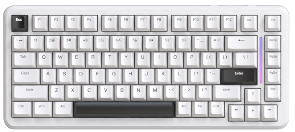

# MONO 75 untuk Linux

Repo ini memasang dan menjalankan aplikasi konfigurasi vendor untuk
keyboard VortexSeries MONO 75 di Linux, lewat Wine. Aplikasi vendornya
adalah `DeviceDriver.exe` versi 1.0.3.5, dari installer Windows
`MONO 75 setup.exe`.

Keyboardnya: VortexSeries MONO 75, 75 persen, 83 tombol plus knob putar.
USB VID 0x1A2C, PID 0x6380, vendor China Resource Semico, kode layout
KB-K102. Kanal konfigurasinya ada di interface HID vendor, report ID
0x07, paket 64 byte.

## Yang tidak ada lagi di repo ini

CLI Python yang lama sudah dihapus. Perintah seperti `mono75 info`,
`mono75 light`, `mono75 list-modes`, `mono75 per-key`, `mono75 keymap`,
`mono75 raw`, dan `mono75-cli` sudah tidak ada dan tidak akan jalan.
Kalau kamu masih punya file `mono75-cli` atau `mono75_linux.py` dari
instalasi lama, installer baru menghapusnya supaya tidak menyesatkan.

Alasannya sederhana: CLI itu tidak jadi dipakai, dan mempertahankannya
hanya membuat README mengklaim hal yang tidak dipegang. Satu jalur
saja yang didukung sekarang: GUI vendor lewat Wine.

## Isi repo

- `bin/mono75`: launcher GUI. Satu-satunya perintah yang didukung.
- `install.sh`: installer. Menyalin launcher, memasang paket aplikasi
  vendor, ikon, desktop entry, dan aturan udev.
- `99-mono75.rules`: aturan udev supaya keyboard bisa diakses tanpa sudo.
- `assets/icon.png`: ikon 512x512.
- `assets/keyboard_layout.png`: gambar layout keyboard.
- `PROTOCOL.md`: dokumentasi hasil reverse engineering protokol HID.
- `LICENSE`: lisensi MIT.

## Instalasi

Satu baris, dari terminal:

```bash
curl -fsSL https://raw.githubusercontent.com/DarulQutni-Q/mono75-linux/main/install.sh | bash
```

Yang dilakukan installer, berurutan:

1. Memasang paket aplikasi vendor ke `~/.local/share/mono75/app/`.
2. Menyalin `bin/mono75` ke `~/.local/bin/mono75`.
3. Memasang ikon ke `~/.local/share/icons/hicolor/512x512/apps/mono75.png`.
4. Membuat desktop entry di `~/.local/share/applications/mono75.desktop`.
5. Memasang `99-mono75.rules` ke `/etc/udev/rules.d/`.
6. Menghapus sisa CLI lama, kalau ada, dan memberi tahu kalau
   `~/.local/bin` belum ada di PATH.

Kalau paket aplikasi vendor gagal diunduh, installer berhenti dengan
error. Installer tidak mengklaim sukses dalam keadaan itu.

## Instalasi manual

```bash
git clone https://github.com/DarulQutni-Q/mono75-linux.git
cd mono75-linux
./install.sh
```

Kalau udev tidak bisa dipasang otomatis karena tidak ada sudo,
pasang manual:

```bash
sudo cp 99-mono75.rules /etc/udev/rules.d/
sudo udevadm control --reload-rules
sudo udevadm trigger
```

Cabut dan colok lagi keyboardnya setelah aturan udev dipasang.

## Menjalankan

Dari launcher aplikasi, cari MONO 75. Atau dari terminal:

```bash
mono75
```

Kalau `mono75` tidak ditemukan, itu hampir pasti karena
`~/.local/bin` belum ada di PATH. Jalankan dengan path lengkap
sampai PATH diperbaiki:

```bash
~/.local/bin/mono75
```

`mono75` tidak punya subcommand. `mono75 -h` hanya menampilkan
bantuan singkat. Argumen lain ditolak dengan pesan yang jelas,
bukan diteruskan diam-diam ke tempat lain.

## Syarat

- Wine, karena aplikasi vendor adalah aplikasi Windows. Tanpa Wine,
  launcher berhenti dengan pesan yang menyebut Wine tidak ditemukan,
  bukan dengan error yang tidak jelas.
- Keyboard tercolok, dan aturan udev sudah dipasang kalau mau akses
  tanpa sudo.
- Tidak butuh Python untuk menjalankan GUI ini. Python hanya relevan
  kalau kamu membaca `PROTOCOL.md` untuk keperluan riset sendiri.

## Hardware

| Parameter | Nilai |
|---|---|
| Nama | VortexSeries MONO 75 |
| VID | 0x1A2C |
| PID | 0x6380 |
| Interface konfigurasi | HID vendor, report ID 0x07 |
| Paket | 64 byte, 1 byte report ID plus 63 byte data |



Gambar di atas adalah layout keyboard, bukan tangkapan layar aplikasi.
Aplikasi vendornya sendiri baru terlihat setelah `mono75` dijalankan.

## Protokol

Detail paket HID, opcode, mode lampu 1 sampai 21, layout tombol, dan
knob ada di `PROTOCOL.md`. Dokumen itu adalah hasil reverse engineering
dari aplikasi vendor, bukan janji bahwa setiap opcode sudah diuji
langsung dengan hardware di semua kondisi. Bagian yang dulu berisi
panduan CLI sudah dihapus bersama CLI-nya. Yang tersisa di dokumen itu
adalah spesifikasi protokol dan penjelasan akses perangkat lewat udev.
